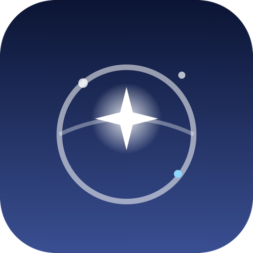
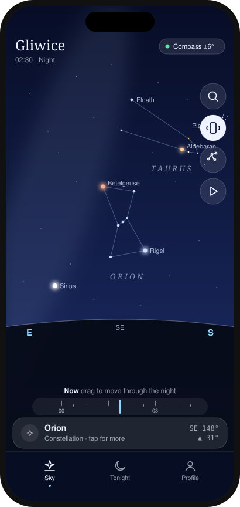
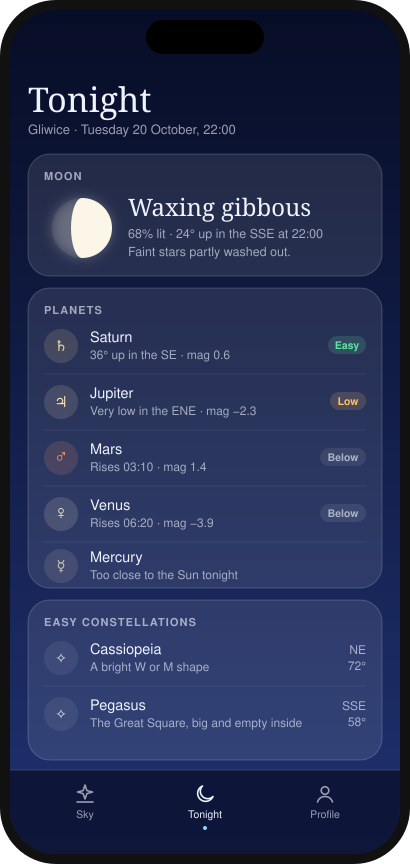
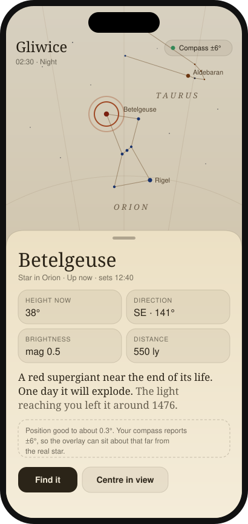

# Caelum

  

<b>Hold your phone up and the real sky over you lines up behind the glass.</b>

Caelum is a free sky map that runs in your phone's browser. Point the phone at any part of the sky and it shows you which stars, planets and constellations are there, even in daylight or through clouds.

  

No download from an app store, no account, no ads.

  
  &nbsp;
  
  &nbsp;
  

Point at the sky · See what's up tonight · Tap any star (shown in the Atlas style)

---

## Getting started

1. Open **[szebastian31.github.io/caelum](https://szebastian31.github.io/caelum/)** on your phone.
2. Tap **Start**. On iPhone, tap **Allow** when it asks about motion.
3. Hold the phone up and look around. The sky moves with you.

That's it. The bar at the bottom always tells you what's in the middle of the screen. Tap it to learn more.

> **On a computer?** Drag with the mouse to look around and scroll to zoom. The motion part needs a phone.

## Add it to your home screen

Then it opens full screen like a normal app, and it works offline, which is handy somewhere dark with no signal.

- **iPhone (Safari):** tap **Share**, then **Add to Home Screen**.
- **Android (Chrome):** tap **⋮**, then **Install app** or **Add to home screen**.

## Things to try

- **🔭 Tap any star or planet** to see what it is, how high it is, when it rises and sets, and how far away it is. For stars, it also tells you roughly when the light you're seeing left them.
- **🔍 Find something.** Tap the magnifying glass and search for "Jupiter" or "Orion". An arrow leads you there, and the phone gives a little tick when you've found it.
- **🕘 Travel through the night.** Drag the time ruler above the bottom bar to fast-forward or rewind, and watch the stars wheel across the sky. Tap **See tonight** during the day to jump to 22:00.
- **🌙 Check the Tonight tab** for the Moon phase, which planets are easy to see, the brightest stars, and constellations worth spotting.
- **🎨 Change the look** in **Profile**. There are five styles, including **Atlas**, which looks like an old paper star chart, and **Red night**, which keeps your eyes adjusted to the dark.
- **📍 Away from home?** In Profile, tap **Use my location** so the sky is right for wherever you are. It defaults to Gliwice, Poland.

## How accurate is it?

The positions of the stars and planets are worked out on your phone for the current minute. They're accurate to well under the width of the Moon.

The weak spot is your phone's compass, which is usually off by about 5 to 15°. The badge at the top of the screen shows how far off it thinks it is. If the sky looks shifted to one side:

- Wave your phone in a slow **figure 8** for a few seconds to recalibrate it.
- Keep away from cars, metal railings and magnetic phone cases or stands.

## Tips for stargazing

- Give your eyes **15–20 minutes** in the dark to adjust. Switch to the **Red night** style so the screen doesn't undo that.
- A thin or missing Moon means darker skies and more stars. The Tonight tab tells you which kind of night it is.
- Planets don't twinkle much. If a bright "star" holds steady, Caelum will probably say it's Jupiter or Venus.
- Never point binoculars or a telescope at the Sun.

## Privacy

Everything happens on your phone. Your location and motion data are only used for drawing the sky and are never sent anywhere. Your settings are saved on your device only.

## Questions or ideas?

Found a bug or have an idea? [Open an issue](https://github.com/Szebastian31/caelum/issues) and describe what happened, what phone you're using, and which browser.

---

*Caelum is Latin for "sky". It's a sibling to Consensus Weather, Fidelis and Vestis.*

For developers

Plain HTML, CSS and JavaScript, with no build step and no dependencies. It's hosted on GitHub Pages.

| File | What it does |
|---|---|
| `index.html` | Layout and styles |
| `data.js` | Star catalogue, constellation lines, stories |
| `astro.js` | Astronomy maths: sidereal time, alt/az, Sun, Moon, planets |
| `app.js` | Sky rendering, drag/zoom, motion sensors, time ruler |
| `ui.js` | Tabs, sheets, Tonight, Profile, saved settings |
| `manifest.webmanifest`, `sw.js` | Home-screen install and offline cache |
| `icons/` | App icons |

Positions use J2000 coordinates with precession applied, plus low-precision formulas for the Sun, Moon and planets. They're accurate to about 0.3°.

After changing any file, bump `VERSION` in `sw.js` (e.g. `caelum-v3`) so installed copies update.

  

