# Caelum

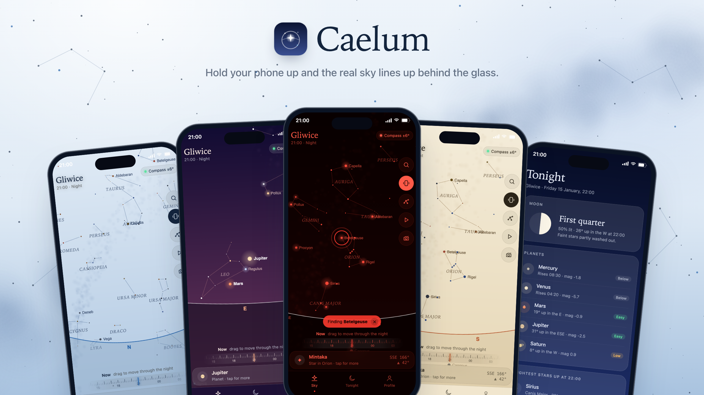

<b>Hold your phone up and the real sky over you lines up behind the glass.</b>

 

No app store, no account, no ads. Get the **Android app**, or use Caelum in any phone's browser. Everything stays on your phone.

---

☕️ You can support me and Buy me a coffee ☕️

https://buycoffee.to/szebastian

---

## What's inside

- **🔭 The real sky, right now.** Point your phone anywhere and Caelum shows the stars, planets, Moon and constellations that are there, calculated on your phone for this minute and your location. It works in daylight and through clouds too.
- **🧭 Honest about the compass.** The badge at the top says how far off your phone's compass thinks it is, like *Compass ±6°*. The star maths is good to a third of a degree; the compass is the weak spot, and Caelum says so.
- **✦ Tap anything.** How high it is, which way to look, when it rises and sets, how far away it is, and for stars, roughly when the light you're seeing left them.
- **🔍 Find.** Search for *Jupiter* or *Orion* and an arrow leads you there, with a little tick when it's in the middle. Tap it again, or the **Finding…** chip, to stop.
- **🌙 Tonight.** The Moon's phase and whether it'll wash out faint stars, which planets are easy to see and where, the brightest stars and constellations worth finding at 22:00.
- **🕘 Travel through the night.** Drag the time ruler to fast-forward or rewind and watch the sky turn. During the day, **See tonight** jumps to 22:00.
- **🌍 Below the horizon.** The ground is tinted, not solid, so you can still see the stars under your feet.
- **📷 Night photos.** In the Android app, the camera button opens your phone's own camera, where you can switch on its Night mode. Press and hold it for Caelum's night camera, which stacks 2, 4 or 8 seconds of frames to pull faint stars out of the noise.
- **▶️ See it move.** The play button sweeps slowly around the whole sky, even while motion is on.
- **🎨 Five skins.** Indigo, Dusk, **Atlas** (an old paper star chart), Glacier and **Red night**, which keeps your eyes used to the dark. The sky runs edge to edge, behind the status bar.

## Screens

  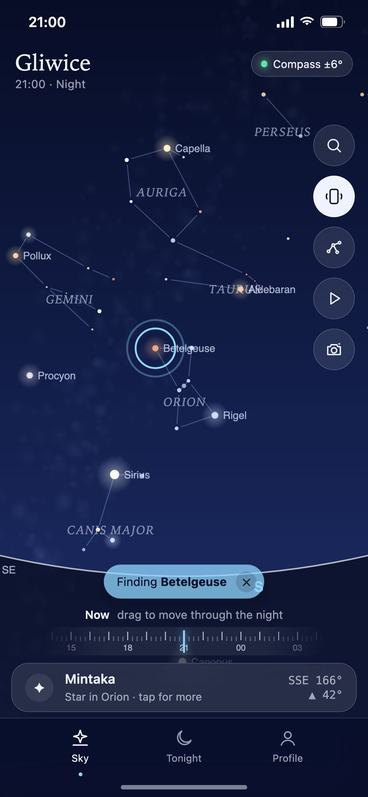
  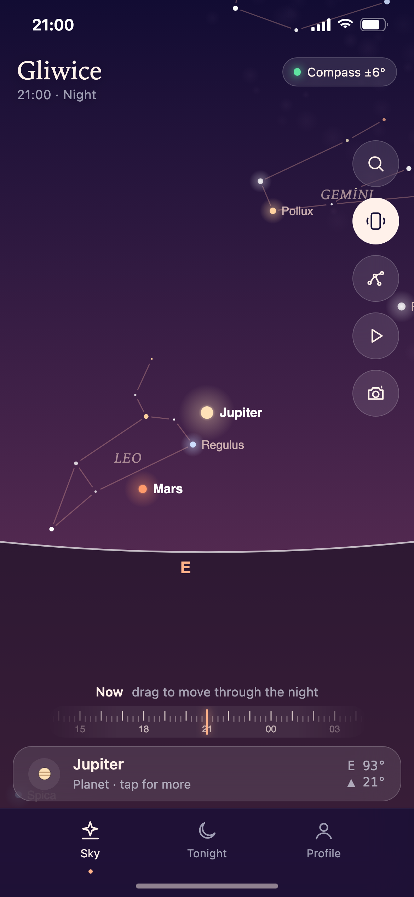
  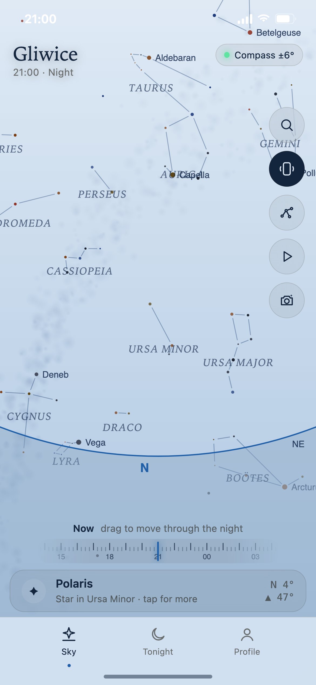
  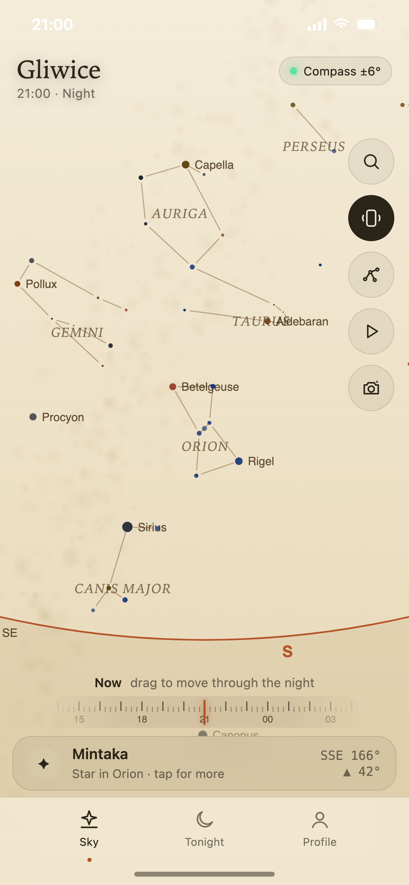
  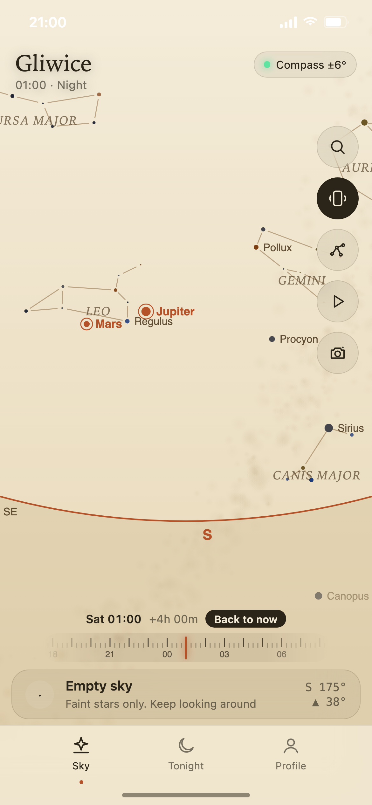

Find a star · Planets · Looking north · Any star's story · Travel through the night

  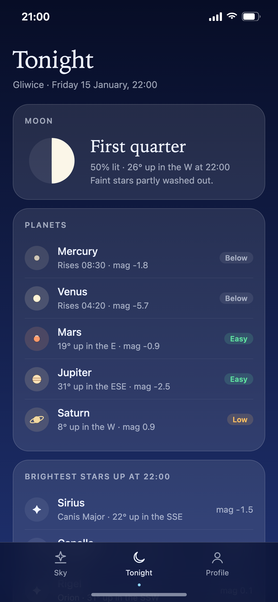
  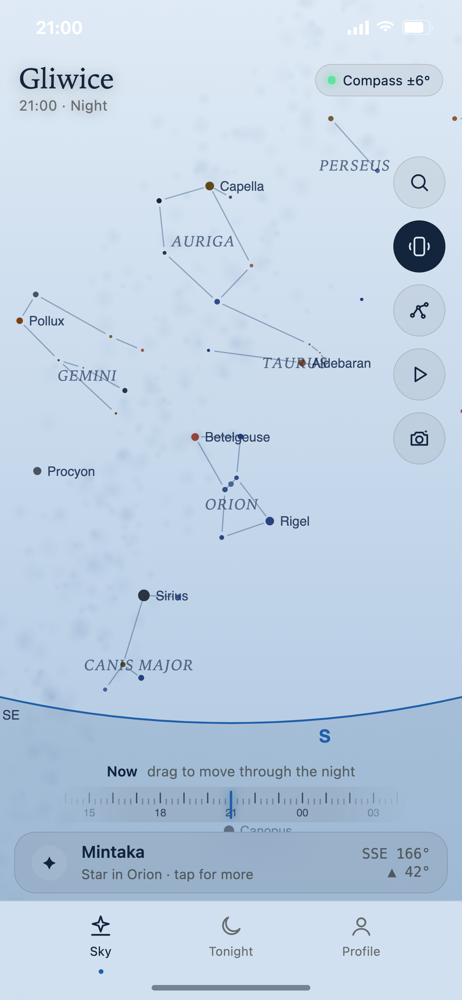
  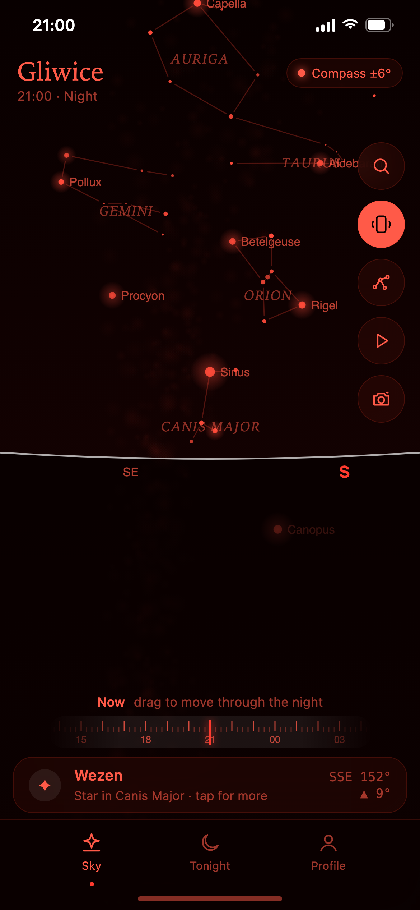
  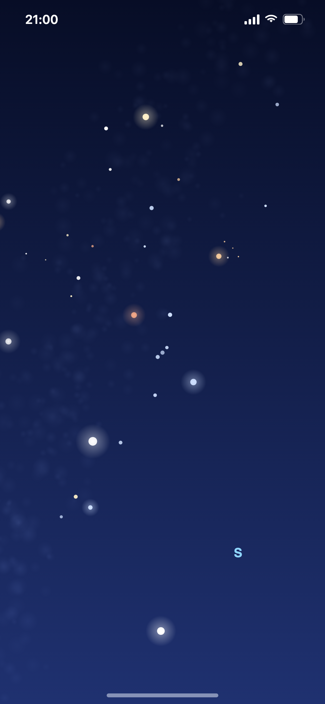
  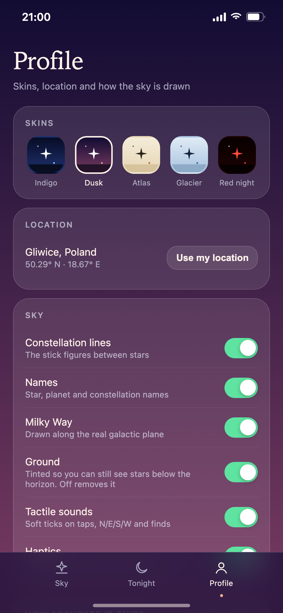

Tonight · Find · Below the horizon (Red night) · Night camera · Skins and settings

## Getting started

### Android app (recommended)

1. Open **[Releases](https://github.com/Szebastian31/caelum/releases/latest)** on your phone and download **Caelum_v….apk**.
2. Open the file. If Android asks, allow your browser to **install unknown apps**.
3. Open Caelum, tap **Start** and hold the phone up. The sky moves with you.

Works on Android 10 and newer, up to Android 16. Updating: download the new APK and install it over the old one. The version you have is shown at the bottom of **Profile**.

### iPhone or any browser

1. Open **[szebastian31.github.io/caelum](https://szebastian31.github.io/caelum/)**.
2. Tap **Start**. On iPhone, tap **Allow** when it asks about motion.
3. **iPhone (Safari):** tap **Share**, then **Add to Home Screen**. **Android (Chrome):** tap **⋮**, then **Install app**. It then works offline too, handy somewhere dark with no signal.

> **On a computer?** Drag with the mouse to look around and scroll to zoom. The motion part needs a phone.

## How accurate is it?

- **Star and planet positions** are worked out on your phone for the current minute, accurate to about 0.3°, less than the width of the Moon.
- **The compass is the weak spot,** usually off by 5 to 15°. If the sky looks shifted to one side, wave your phone in a slow **figure 8** for a few seconds, and keep away from cars, metal railings and magnetic cases or stands.
- **The catalogue** has about 120 of the brightest stars and 20 constellations, everything you can easily see from a town. Faint stars aren't drawn yet.

## Tips for stargazing

- Give your eyes **15–20 minutes** in the dark. Switch to **Red night** so the screen doesn't undo that.
- A thin or missing Moon means more stars. The Tonight tab tells you which kind of night it is.
- Planets don't twinkle much. If a bright "star" holds steady, Caelum will probably say it's Jupiter or Venus.
- Never point binoculars or a telescope at the Sun.

## Privacy

Everything stays on your phone. Your location, motion data and photos are used on your device only and never uploaded, and your settings are saved on your device only.

## Questions or ideas?

Found a bug? [Open an issue](https://github.com/Szebastian31/caelum/issues) and describe what happened, which phone you use and which browser. If the Android app stopped, it shows the error the next time you open it: tap **Share** and paste it into the issue.

---

_Caelum is Latin for "sky". It's a sibling to Consensus Weather, Kalendae, Augur, Fidelis, Vestis and Hora._

For developers

The interface is plain HTML, CSS and JavaScript, hosted on GitHub Pages. The Android app (`app/`) bundles those same files into a native WebView shell that draws edge to edge and adds the phone's camera app, saving photos to the gallery, keeping the screen on and vibration. It targets Android 16 (API 36) and handles back through the new back callback, keeping `onBackPressed` for Android 12 and older. GitHub Actions builds the APK on every push and publishes it as a release.

| File | What it does |
| --- | --- |
| `index.html` | Layout and styles |
| `data.js` | Star catalogue, constellation lines, stories |
| `astro.js` | Astronomy maths: sidereal time, alt/az, Sun, Moon, planets |
| `app.js` | Sky rendering, drag/zoom, motion sensors, time ruler |
| `ui.js` | Tabs, sheets, Tonight, Profile, saved settings |
| `camera.js` | Night camera (frame stacking) and the hand-off to the phone's camera app |
| `demo.js` | The fixed scenes used for screenshots: `?demo=` sky, planet, north, star, time, below, tonight, find, camera, styles |
| `manifest.webmanifest`, `sw.js` | Home-screen install and offline cache |
| `icons/` | App icons |
| `tools/screenshots.sh` | Makes everything in `screenshots/` from the real app |
| `app/` | Android app: WebView shell, edge to edge, camera app, gallery saving, crash screen |
| `keystore/` | The signing key, so each APK installs over the last one |
| `.github/workflows/build.yml` | Builds the APK and publishes it as a release |

After changing any file, bump `VERSION` in `sw.js` so installed web copies update, and `versionName` + `versionCode` in `app/build.gradle` for a new APK release. If you add a `.js` file, add it to `index.html`, `sw.js` and the `copyWebApp` list in `app/build.gradle`.

**Screenshots:** `tools/screenshots.sh` (each scene in its own skin), or `tools/screenshots.sh dusk` for all in one skin. It needs Google Chrome and touches none of your own data. Without it, `index.html?demo=sky&skin=atlas` shows the same fixed night in any browser.

