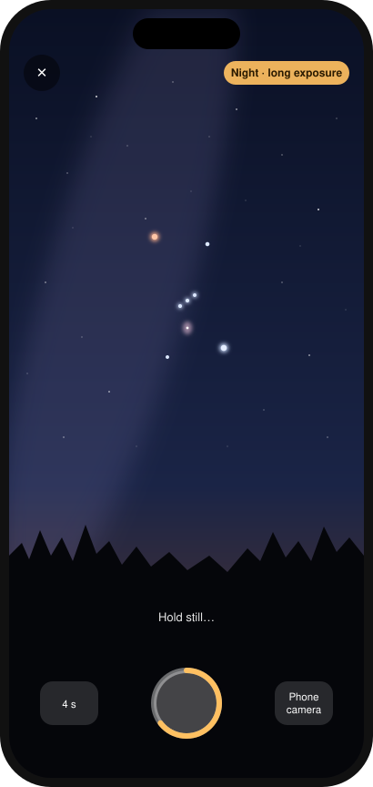

# Caelum

  

<b>Hold your phone up and the real sky over you lines up behind the glass.</b>

Caelum is a free sky map for your phone. Point it at any part of the sky and it shows you which stars, planets and constellations are there, even in daylight or through clouds. When you've found something, take a night photo of it.

  
  

No app store, no account, no ads. Get the <b>Android app</b>, or use Caelum in any phone's browser.

  
  &nbsp;
  
  &nbsp;
  
  &nbsp;
  

Find anything in the sky · See what's up tonight · Tap any star (Atlas style) · Take a night photo

---

☕️ You can support me and Buy me a coffee ☕️

  
https://buycoffee.to/szebastian

---

## Getting started

### Android app (recommended)

1. Open **[Releases](https://github.com/Szebastian31/caelum/releases/latest)** on your phone and download **Caelum_v….apk**.
2. Open the file. If Android asks, allow your browser to **install unknown apps**.
3. Open Caelum, tap **Start** and hold the phone up. The sky moves with you.

The app keeps the screen awake while you stargaze, opens your phone's own camera with all its modes, and saves photos straight to your gallery.

### iPhone or any browser

1. Open **[szebastian31.github.io/caelum](https://szebastian31.github.io/caelum/)**.
2. Tap **Start**. On iPhone, tap **Allow** when it asks about motion.
3. To keep it on your home screen: **iPhone (Safari):** tap **Share**, then **Add to Home Screen**. **Android (Chrome):** tap **⋮**, then **Install app**. It then works offline too, handy somewhere dark with no signal.

The bar at the bottom always tells you what's in the middle of the screen. Tap it to learn more.

> **On a computer?** Drag with the mouse to look around and scroll to zoom. The motion part needs a phone.

## Things to try

- **🔭 Tap any star or planet** to see what it is, how high it is, when it rises and sets, and how far away it is. For stars, it also tells you roughly when the light you're seeing left them.
- **🔍 Find something.** Tap the magnifying glass and search for "Jupiter" or "Orion". An arrow leads you there, and the phone gives a little tick when you've found it. To stop, tap the object again or the **Finding…** chip.
- **📷 Take a night photo.** In the Android app, tap the camera button to open your phone's own camera, then switch it to Night mode. **Press and hold** the button for Caelum's night camera instead: it stacks 2, 4 or 8 seconds of frames to pull faint stars out of the noise, so rest the phone on something steady. In a browser, a tap opens Caelum's night camera.
- **▶️ See it move.** The play button sweeps slowly around the whole sky, even while motion is on. Tap it again or touch the screen to stop.
- **🌍 Below the horizon.** The ground is tinted, not solid, so you can still see the stars under your feet. Point down and Caelum names them.
- **🕘 Travel through the night.** Drag the time ruler above the bottom bar to fast-forward or rewind, and watch the stars wheel across the sky. Tap **See tonight** during the day to jump to 22:00.
- **🌙 Check the Tonight tab** for the Moon phase, which planets are easy to see, the brightest stars, and constellations worth spotting.
- **🎨 Change the look** in **Profile**. There are five styles, including **Atlas**, which looks like an old paper star chart, and **Red night**, which keeps your eyes adjusted to the dark.
- **📍 Away from home?** In Profile, tap **Use my location** so the sky is right for wherever you are. It defaults to Gliwice, Poland.

## How accurate is it?

The positions of the stars and planets are worked out on your phone for the current minute. They're accurate to well under the width of the Moon.

The weak spot is your phone's compass, which is usually off by about 5 to 15°. The badge at the top of the screen shows how far off it thinks it is. If the sky looks shifted to one side:

- Wave your phone in a slow **figure 8** for a few seconds to recalibrate it.
- Keep away from cars, metal railings and magnetic phone cases or stands.

## Tips for stargazing

- Give your eyes **15–20 minutes** in the dark to adjust. Switch to the **Red night** style so the screen doesn't undo that.
- A thin or missing Moon means darker skies and more stars. The Tonight tab tells you which kind of night it is.
- Planets don't twinkle much. If a bright "star" holds steady, Caelum will probably say it's Jupiter or Venus.
- Never point binoculars or a telescope at the Sun.

## Privacy

Everything happens on your phone. Your location, motion data and photos are only used on your device and are never uploaded. Your settings are saved on your device only.

## Questions or ideas?

Found a bug or have an idea? [Open an issue](https://github.com/Szebastian31/caelum/issues) and describe what happened, what phone you're using, and which browser.

---

*Caelum is Latin for "sky". It's a sibling to Consensus Weather, Fidelis, Vestis and Hora.*

For developers

The interface is plain HTML, CSS and JavaScript, hosted on GitHub Pages. The Android app (`app/`) bundles those same files into a native shell that adds the phone's camera app, saving to the gallery and keeping the screen on. GitHub Actions builds the APK on every push.

| File | What it does |
|---|---|
| `index.html` | Layout and styles |
| `data.js` | Star catalogue, constellation lines, stories |
| `astro.js` | Astronomy maths: sidereal time, alt/az, Sun, Moon, planets |
| `app.js` | Sky rendering, drag/zoom, motion sensors, time ruler |
| `ui.js` | Tabs, sheets, Tonight, Profile, saved settings |
| `camera.js` | Night camera (frame stacking) and the phone camera hand-off |
| `manifest.webmanifest`, `sw.js` | Home-screen install and offline cache |
| `icons/` | App icons |
| `app/` | Android app: WebView shell, camera intent, gallery saving |
| `.github/workflows/build.yml` | Builds the APK and publishes it as a release |

Positions use J2000 coordinates with precession applied, plus low-precision formulas for the Sun, Moon and planets. They're accurate to about 0.3°.

After changing any file, bump `VERSION` in `sw.js` so installed web copies update, and `versionName` + `versionCode` in `app/build.gradle` for a new APK release.

  

